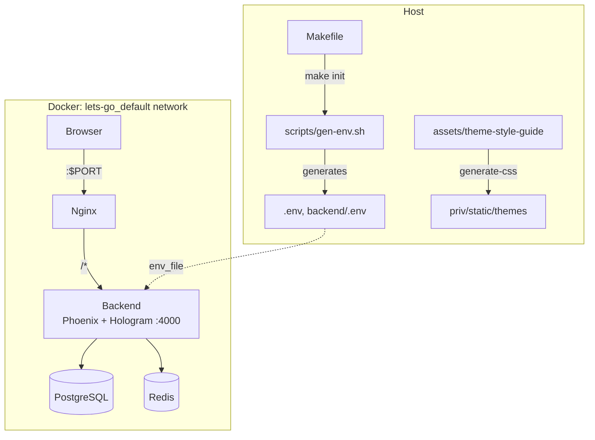

# Architecture — hologram-start-app

Reusable annotate template for portfolio projects that prefer **Hologram** (isomorphic Elixir UI) over Next.js. Two Docker containers — **Phoenix + Hologram backend**, **nginx reverse proxy** — sharing Postgres/Redis on the external Docker network.

Sibling of [`components/start-app`](../../start-app) (Next.js). Backend domain logic, Liquibase schema, SSO, and style-guide YAML themes are shared; the UI layer is Hologram.

## System Diagram

## Core Components

| Component | Purpose |
|-----------|---------|
| **nginx** | Reverse proxy — all traffic to the unified backend |
| **backend** | Phoenix 1.8 JSON API + Hologram pages/commands |
| **Hologram UI** | `AnnotateWeb.Hologram.*` pages, components, sections; auth middleware (`require_auth`, `require_admin`) |
| **Style-guide CSS** | YAML-driven design tokens served from `/themes/*`; this app owns the Hologram design-system components |
| **PBAC engine** | Group/scoped-membership + JSONB policy authorization, evaluated in-database (see [PROJ-SCHEMA.md](PROJ-SCHEMA.md)) |
| **Auth stack** | Guardian JWT (API), Hologram session (UI), smart tokens (email/magic link), SSO (OIDC via Authentik, domain policy via `SSO_DOMAINS`) |
| **Workers** | Oban jobs — `CleanupWorker`, `EmailWorker`; webhooks via `Annotate.Events.WebhookHandler` |
| **Media pipeline** | Upload → transform (`Annotate.Media.Transform`, ex_aws/vix) → variants cache; short-id + visibility scoping |
| **Makefile** | Build orchestration and project identity |
| **helm/hologram-start-app/** | K8s chart (backend pod + migrate job + sandbox lane) |

## Request Routing

nginx proxies `/socket` (WebSocket, Hologram client runtime) and `/` to the backend; `/otel/` goes to the OTLP collector. Within Phoenix:

| Pattern | Destination | Notes |
|---------|-------------|-------|
| `/api/v1/*`, `/health` | `AnnotateWeb.Router` | JSON API (JWT) |
| `/auth/*` (OIDC/OAuth), `/sso/*` | `AnnotateWeb.Router` | SSO redirect flows + code exchange |
| `/socket` | `UserSocket` | Hologram client runtime channel |
| `/themes/*`, `/twp/*`, static | Plug.Static | Design-system CSS + Tailwind Plus demos |
| `/*` | `Hologram.Router` | Pages (see README for the page map) |

Plugs apply auth pipeline, CORS, rate limiting (Hammer), and OTel logger metadata; Hologram pages gate on `require_auth`/`require_admin` middleware.

## Client / Server Boundary (Hologram)

| Concern | Client (`action/3`) | Server (`command/3` / `init/3`) |
|---------|---------------------|----------------------------------|
| Form field edits, step transitions | yes | — |
| Login / register / profile save | optimistic UI only | Guardian + Users domain |
| SSO catalog, current user | seeded in `init` | session + DB |
| Cookie consent | banner visibility | session write |

Auth tokens for the Hologram UI live in the **Hologram/Phoenix session**. The JSON API continues to accept Bearer JWT for external clients.

## Design System

- Theme YAML: `assets/theme-style-guide/` (canonical) + `backend/themes/theme-*/` (runtime-discovered themes)
- Generated CSS: `backend/priv/static/themes/` (`make regen` via `assets/scripts/generate-css.ts` + `@noizu/styleguide`)
- Components map 1:1 to styleguide React primitives (`Btn` → `StyleGuideBtn`, etc.) using semantic classes (`btn`, `card`, …)
- Interactive viewer at `/styleguide` (+ `/styleguide/tailwind-plus`) — component browser, color palettes, shell layouts
- **tobor-kit Hologram mirror**: path dep `:tobor_kit_hologram` (Lit → native Hologram component kit from `Portfolio/Libs/tobor-kit/hologram`); browser verification page at `/tk-smoke` (stateless + stateful mirrors, event-forward contract) with `tobor-kit.css` linked in the main layout

## Authorization (PBAC)

Access control is policy-based: users/groups hold `scoped_memberships` on resources (organization | project); groups attach JSONB `policies` (IAM-style statements). Evaluation runs in-database (`check_user_permission` PL/pgSQL, deny-overrides-allow, wildcard + template matching). Per-org `custom_roles` extend the system groups. Legacy flat `memberships` were migrated in changeset 021.

## Background & Events

Oban-backed workers (`CleanupWorker`, `EmailWorker`) handle cleanup and mail; outbound `webhooks` deliver org events via `Annotate.Events.WebhookHandler`. Redis backs rate limiting and runtime coordination (`Annotate.Redis`).

## Observability

OpenTelemetry instrumentation (OTLP via nginx `/otel/` → collector) with JSON logging (`logger_json`) and `Plugs.OtelLoggerMetadata`.

## Deployment

Local/dev: docker-compose (`.dev.yaml` hot reload, `mix holo` requires `HOLOGRAM_START=1` — pages 404 without it). Production: Helm chart (ArgoCD auto-sync) with pre-deploy `migrate-job`, Infisical-sourced secrets/TLS, HPA/PDB, and a parallel `sandbox` lane (`Dockerfile.sandbox`, `values-sandbox.yaml`). Release path is git-driven (push to main → CI builds `sha-*` images → Argo syncs).

## Technology Stack

| Layer | Choice |
|-------|--------|
| UI | Hologram ~> 0.10, Elixir transpiled to JS |
| API | Phoenix 1.8, Bandit, Guardian JWT |
| Database | PostgreSQL (PostGIS, pgvector) + Liquibase |
| Cache | Redis |
| Jobs | Oban |
| Auth | Guardian + smart_token + Ueberauth/OIDC/SAML SSO |
| Design | @noizu/styleguide CSS tokens |
| Observability | OpenTelemetry + logger_json |
| Proxy | Nginx |
| Orchestration | Docker Compose + Helm (ArgoCD) |

→ *Backend internals: [backend/docs/PROJ-ARCH.md](../backend/docs/PROJ-ARCH.md) · Schema: [PROJ-SCHEMA.md](PROJ-SCHEMA.md) · Scaffolding: [SCAFFOLDING.md](SCAFFOLDING.md)*
