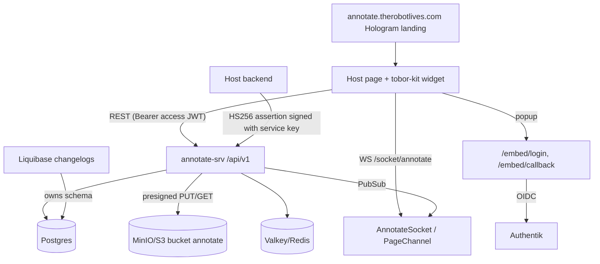

# Architecture — annotate.therobotlives.com

Annotate is an **embeddable, multi-tenant comments service**: a host page drops in a widget (tobor-kit page-comments, served from `cdn.derobot.is`) that talks to this service for sites, pages, threads, comments and attachments. Security counterpart: [THREAT-MODEL.md](THREAT-MODEL.md). API contract: [API.md](API.md). Embed auth details: [EMBED-AUTH.md](EMBED-AUTH.md). Test posture: [TEST-HEALTH.md](TEST-HEALTH.md).

Last verified against `develop` @ `2b5819d` (2026-10-17). Claims below cite modules under `backend/lib/`; anything not verifiable from this repo is marked **unknown**.

The repo was hydrated from the Hologram scaffold, so a large inherited surface (PBAC, organizations, invites, password/magic-link auth, SSO domains, webhooks, media pipeline) still ships in the same release. Those parts are **not** the annotate product path; they are listed under "Inherited scaffold surface" and covered only briefly.

## Two hosts, one app

| Host | Role | Evidence |
|---|---|---|
| `annotate-srv.therobotlives.com` | JSON API `/api/v1/*`, popup auth broker `/embed/*`, websocket `/socket/annotate` | `AnnotateWeb.Router`, `AnnotateWeb.Endpoint` |
| `annotate.therobotlives.com` | Marketing landing ("Night Desk" design), a Hologram page that dogfoods the live widget | `AnnotateWeb.Plugs.MarketingHostGate`, `lib/annotate_web/hologram/` |

Both hosts terminate at the same Phoenix release. `MarketingHostGate` 302s `/` on the API host to the marketing host and adds CSP, `x-frame-options: DENY`, `nosniff` and a referrer policy on the landing path only. Hosts come from `config :annotate, :marketing`. The landing's widget config (`api_base`, widget `src`, `dogfood_site`) is set in `config/runtime.exs` (`ANNOTATE_PUBLIC_API_BASE`, `ANNOTATE_PUBLIC_WIDGET_SRC`, `ANNOTATE_DOGFOOD_SITE`).

## Domain model (Liquibase `backend/db/changelog/028-annotate-core.yaml`, `029`, `030`; Ecto schemas `Annotate.Schema.Annotate.*`)

| Entity | Notes | Module |
|---|---|---|
| `Site` | tenant: `slug`, `allowed_origins`, `comment_policy`, `settings`, `owner_commenter_id`, `service_key_hash`, `service_key_encrypted` | `schema/annotate/site.ex`, `Annotate.Sites` |
| `Commenter` | identity: Authentik (`authentik_sub`), host-asserted (`site_id`+`external_id`), or guest (`external_id = "guest:<name>"`) | `schema/annotate/commenter.ex` |
| `Page` | `(site_id, page_key)` upsert; `page_key` 1..255 bytes | `Annotate.Comments.upsert_page/4` |
| `Thread` | anchor map, `status` open/resolved, `orphaned_at` | `Annotate.Comments` |
| `Comment` | `body_md`, optional `parent_id`, soft delete (`deleted_at`), `edited_at` | `Annotate.Comments` |
| `Attachment` | `pending` -> `ready`; storage key `annotate/<site_id>/<uuid>/<sanitised filename>` | `Annotate.Comments`, `Annotate.Storage` |
| `RefreshToken` | sha256 of opaque token, `expires_at`, `revoked_at`, persisted `identity_claims` | `Annotate.Auth.RefreshTokens` |

Sites can only be provisioned from the CLI (`mix annotate.site.create`, `lib/mix/tasks/annotate.site.create.ex`); there is no HTTP site-management API on `develop`. A `feature/site-management` branch exists upstream and is not covered here.

Tenancy is enforced by scoping every lookup with the token's site: `Comments.get_thread_for_site/2`, `get_comment_for_site/2`, `get_attachment_for_site/2` join through `pages.site_id` / `attachments.site_id`.

## Request flow (embed API)

1. **Endpoint plugs** (`AnnotateWeb.Endpoint`): `AnnotateCORS` (per-site CORS, before body parsing) -> broad scaffold `CORS` (skipped on claimed annotate prefixes) -> `Plug.Parsers` (urlencoded, multipart, json; no explicit body-size length set) -> `Plugs.Session` -> `MarketingHostGate` -> `Hologram.Router` -> `AnnotateWeb.Router`.
2. **Router pipelines** (`router.ex`): `:annotate_rate_limited` (`RateLimit` action `:annotate_write`, 60 writes / 60 s keyed `ip:site`) then `:annotate_auth_optional` or `:annotate_auth_required` (`Plugs.AnnotateAuth`).
3. **AnnotateAuth** verifies the HS256 access token, then enforces the `site` claim == addressed site (403), and `origin` claim == request `Origin` (401; writes with no Origin header are rejected, reads tolerate it). Anonymous fallback: GET/HEAD when `settings.public_read`; POST (thread create) only when `comment_policy.allow_anonymous`.
4. **Controllers** under `controllers/annotate_api/`: `SiteThreadsController` (list/create thread), `ThreadCommentsController` (comment, resolve, reopen, re-anchor), `CommentController` (edit/delete), `AttachmentController` (presign/complete), `TokenController` (refresh, host-assert), `EmbedController` (popup broker). `Renderer` is the single JSON shape shared by REST and realtime.
5. **Domain** (`Annotate.Comments`, `Annotate.Sites`) writes in `Repo.transaction`s, then calls `Annotate.Realtime` to broadcast.

| Route | Auth | Controller |
|---|---|---|
| `GET/POST /api/v1/sites/:site/threads` | optional | `SiteThreadsController` |
| `POST /api/v1/threads/:id/comments`, `/resolve`, `/reopen`; `PATCH /threads/:id/anchor` | required | `ThreadCommentsController` |
| `PATCH/DELETE /api/v1/comments/:id` | required (author or site owner) | `CommentController` |
| `POST /api/v1/attachments/presign`, `/attachments/:id/complete` | required (uploader only for complete) | `AttachmentController` |
| `POST /api/v1/token/refresh` | refresh token in body | `TokenController.refresh` |
| `POST /api/v1/token/revoke` | refresh token in body (sign-out; revokes the family) | `TokenController.revoke` |
| `POST /api/v1/sites/:site/token/assert` | service-key-signed JWT in body | `TokenController.host_assert` |
| `GET /embed/login`, `/embed/callback` | signed session cookie | `EmbedController` |

## Identity and tokens

- **Access token**: HS256 JWT, 15 min, claims `sub` (commenter id), `site`, `origin`, `typ=annotate_access` (`Annotate.Auth.ApiToken`). Signing key = sha256 of `ANNOTATE_JWT_SECRET`. `verify/1` rejects non-HS256 `alg`, wrong `typ`, missing/expired `exp`.
- **Refresh token**: 32 random bytes, url64, 30 days, only sha256 stored. Single use: `RefreshTokens.rotate/1` revokes the presented row then issues a new one, after re-running the site's *current* `comment_policy` against `identity_claims` stored at issuance (a policy failure kills the session, 403 `policy_violation`).
- **Authentik popup login**: `/embed/login?site=&origin=` validates `origin` against `allowed_origins`, stores `{site_id, origin, state, nonce}` in the signed `_annotate_sso` cookie (SameSite=Lax, max-age 900, router.ex `:sso_session`) and redirects to Authentik. `/embed/callback` verifies `state` (constant time), exchanges the code server-side, verifies the ID token, checks `nonce`, applies `Annotate.Embed.Policy`, upserts the commenter by `authentik_sub`, then renders a small HTML page that `postMessage`s `{access, refresh, commenter, display_name}` to the registered origin and closes. Errors postMessage `annotate-auth-error` with an allowlisted reason. Redirect URI = `EMBED_OIDC_REDIRECT_URI` (default `https://<host>/embed/callback`). OIDC seam: `Annotate.Embed.OIDC`.
- **Host-assert**: the site's backend signs a <=5 minute HS256 JWT (`sub`, `name`, optional `email`/`avatar`/`groups`) with the site **service key** and POSTs it to `/sites/:site/token/assert`; the server decrypts the stored key, verifies, applies `comment_policy`, upserts a commenter by `(site_id, external_id)` and returns an access/refresh pair. Service key: 32 random bytes, shown once, stored as sha256 hex plus AES-256-GCM sealed under a key derived from `ANNOTATE_KEY_ENC_SECRET` (`Annotate.Auth.ServiceKey`).
- **Comment policy** (`Annotate.Embed.Policy`): `required_groups` (any-of), `allowed_email_domains`, `allow_anonymous` (read in `Sites.allow_anonymous?/1`), `host_identity` (declarative only).
- Prod boot fails closed if `ANNOTATE_JWT_SECRET` / `ANNOTATE_KEY_ENC_SECRET` are unset (`config/runtime.exs`); non-prod falls back to committed dev strings.

## Authorization on comments

Author or the site's `owner_commenter_id` may edit/delete (`Comments.comment_manageable_by?/3`). **Resolve, reopen and re-anchor require only a valid site token, not authorship** (`ThreadCommentsController`) - see THREAT-MODEL T-12. Guests (token-less thread creation) have no token path and can never edit.

## Attachments (MinIO / S3)

`AttachmentController.presign` validates `kind` (file/image/screenshot), a content-type allowlist (`png jpeg webp gif pdf text/plain`), filename length 1..1024 and `bytes <= settings.max_upload_mb` (default 20), inserts a `pending` row, and returns a presigned PUT (1 h, `content-type` header signed) from `Annotate.Storage` (ExAws S3). `complete` flips `pending -> ready` for the uploader only. Only `ready`, unbound attachments owned by the same commenter and site can be bound to a new comment (`Comments.fetch_bindable_attachments`). Reads render presigned GET URLs (1 h) in `Renderer.attachment/1`. `Workers.AttachmentSweeper` (Oban, hourly) deletes `pending` **rows** older than 24 h; it does not delete storage objects (see THREAT-MODEL T-08). Bucket `annotate` lives on annotate's dedicated MinIO (chart `files:` values, `helm/annotate/templates/files-*.yaml`; S3 API at `annotate-files.therobotlives.com`, console disabled). The `files-bootstrap` ArgoCD Sync hook creates the private bucket and a bucket-scoped app user (policy `annotate-app`: list/get/put/delete on `annotate` only). The legacy shared-MinIO bucket (`terraform/kubernetes/init/annotate-minio.tf` in the monorepo) is retained as a backup.

## Realtime

`/socket/annotate` (`AnnotateWeb.AnnotateSocket`, websocket only). Transport `check_origin/1` accepts only origins present in *any* site's `allowed_origins`; `connect/3` binds the handshake origin to the named site and verifies a presented token (absence = anonymous). `AnnotateWeb.PageChannel` serves topics `page:<site_slug>:<sha256(page_key)>`; join requires site match plus either `public_read` (anonymous) or token with matching `site` claim and `origin` in `allowed_origins`. The channel is read-only (`handle_in` rejects all). `Annotate.Realtime` broadcasts the REST-identical rendered payloads on `Annotate.PubSub` after commits. Events: `thread_created`, `comment_created`, `comment_updated`, `comment_deleted`, `thread_resolved`, `thread_reopened`, `thread_anchor_updated`.

## Rate limiting

`AnnotateWeb.Plugs.RateLimit` (Hammer 6.2, **ETS backend**, `config/config.exs`): `auth` 10/60 s, `auth_sensitive` 5/60 s, `annotate_write` 60/60 s (write methods only; GET/HEAD/OPTIONS uncounted). Bucket key `action:ip[:site]`. Counters are per pod (ETS); there is no shared store. Client IP = first `X-Forwarded-For` entry.

## Schema and migrations

**Liquibase owns the schema** (`backend/db/changelog/*.yaml`, master `db.changelog-master.yaml`; annotate tables in `028`-`030`). The Helm pre-install/pre-upgrade hook `helm/annotate/templates/migrate-job.yaml` runs `bin/annotate eval "Annotate.Release.migrate()"`, i.e. **Ecto-only** migrations (Oban and SmartToken tables); it does not run Liquibase. Liquibase is applied out-of-band via `liquibase-shell` against target `annotate` (`.infra-config.yaml` in the monorepo). Verify `databasechangelog` before releasing code that needs new columns. The `mix test` alias runs `ecto.create -> liquibase.update -> ecto.migrate` (`mix.exs`, `lib/mix/tasks/liquibase.update.ex`).

## Inherited scaffold surface (not the product path)

Orgs/memberships/projects/custom roles/PBAC policies (`router.ex` `/api/v1/organizations/...`, `/policies`), password/magic-link/OTP auth, invite gate (`Plugs.RequireInvite`), SSO domain policy, SAML/OIDC/social login, webhooks (`Annotate.Events.WebhookHandler`), media pipeline (`/media/*`), Oban workers, Hologram style-guide pages, Guardian sessions. These are exposed on the same hosts and widen the attack surface; whether prod disables any of them is **unknown** (not determinable from the repo; no feature flags found beyond `Annotate.FeatureFlags`).

## Deployment

Helm chart `helm/annotate` (backend deployment, ingress for `domain` and `appDomain`, optional Cloudflare-only whitelist, HPA, PDB, migrate Job hook). Images are built by CI (`.github/workflows/ci.yml`); CI commits the chart tag bump; ArgoCD syncs from the chart repo `main` (monorepo `argocd/apps/annotate.yaml`). Secrets come from Infisical path `/apps/annotate` -> k8s Secret `annotate-secrets`. Postgres database `annotate`, Valkey db 16 with an `annotate` ACL user, MinIO bucket `annotate` (all monorepo Terraform). The docker-compose `nginx/` proxy is a local-dev stack; whether prod ingress rewrites `X-Forwarded-For` is **unknown**.

## Technology

Elixir 1.20.1 / OTP 29 (`.tool-versions`), Phoenix + Bandit, Hologram 0.10.x, Ecto + Postgres, Oban, Hammer 6.2, JOSE (JWT), OpenIDConnect 1.0.1, Guardian (scaffold), ExAws S3, Phoenix.PubSub.
