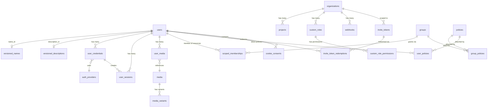

# Database Schema Summary — hologram-start-app

26 tables across 6 domains. All tables use UUID PKs and TIMESTAMPTZ timestamps. Managed by Liquibase YAML changelogs (000–025); smart_token + Oban tables via Ecto migrations. Detail: [PROJ-SCHEMA.md](PROJ-SCHEMA.md) and [schema/](schema/).

## Extensions

citext, uuid-ossp, postgis, vector, cube, pg_trgm, earthdistance

## Enum Types

status_enum, user_status_enum (+ 'pending' in 025), credential_status_enum, session_status_enum, media_type_enum, file_type_enum, owner_type_enum, credential_type_enum, device_type_enum; PBAC (013): member_type_enum (user,group), resource_type_enum (organization,project), role_name_enum (owner,admin,member,viewer)

## Tables

| Table | Domain | Columns | Key Relationships |
|-------|--------|---------|-------------------|
| seed_helper_records | Infrastructure | 5 | — |
| versioned_strings | Versioned | 5 | — |
| versioned_names | Versioned | 7 | — |
| versioned_descriptions | Versioned | 6 | — |
| auth_providers | Auth | 7 | — |
| users | Users | 20 | → versioned_names, versioned_descriptions, invite_tokens |
| user_credentials | Users | 11 | → users, auth_providers, versioned_descriptions |
| user_sessions | Users | 8 | → users, user_credentials |
| media | Media | 13 | owner_type/owner_id polymorphic |
| media_variants | Media | 7 | → media |
| user_media | Users | 9 | → users, media, versioned_descriptions |
| organizations | Orgs | 6 | — |
| memberships (legacy) | Orgs | 6 | renamed memberships_legacy in 021; rows moved to scoped_memberships |
| invite_tokens | Orgs | 17 | → organizations, users |
| invite_token_redemptions | Orgs | 8 | → invite_tokens, users |
| webhooks | Webhooks | 8 | → organizations |
| projects | Projects | 11 | → organizations, users |
| groups | PBAC | 7 | self-hierarchy via group_hierarchy |
| group_hierarchy | PBAC | 3 | → groups (ancestor/descendant) |
| scoped_memberships | PBAC | 9 | → groups, users; (resource_type, resource_id) polymorphic |
| policies | PBAC | 9 | JSONB policy_document |
| group_policies | PBAC | 5 | → groups, policies |
| user_policies | PBAC | 7 | → users, policies |
| custom_roles | Orgs | 8 | → organizations |
| custom_role_permissions | Orgs | 5 | → custom_roles |
| cookie_consents | Consent | 10 | → users (or anonymous browser_session_id) |

## ERD

## Changeset Reference

| # | Name | Creates |
|---|------|---------|
| 000 | extensions | 7 PG extensions |
| 001 | enums | 9 enum types |
| 002 | seed-helper | seed_helper_records |
| 003 | versioned-entities | versioned_strings, versioned_names, versioned_descriptions |
| 004 | auth-providers | auth_providers |
| 005 | media | media |
| 006 | users | users + indexes |
| 007 | user-media | user_media + index |
| 008 | credentials-sessions | user_credentials, user_sessions + indexes |
| 009 | organizations | organizations, memberships + unique constraint |
| 010 | invite-tokens | invite_tokens + indexes |
| 011 | webhooks | webhooks |
| 012 | admin-flag | users.admin |
| 013 | pbac-enums | member_type_enum, resource_type_enum, role_name_enum |
| 014 | pbac-groups | groups, group_hierarchy + triggers |
| 015 | pbac-scoped-memberships | scoped_memberships + cascade trigger |
| 016 | pbac-policies | policies, group_policies, user_policies |
| 017 | projects | projects |
| 018 | custom-roles | custom_roles, custom_role_permissions |
| 019 | pbac-stored-procedures | 6 PL/pgSQL functions (permission engine) |
| 020 | pbac-seed-data | system groups + policies |
| 021 | migrate-memberships-to-pbac | memberships → scoped_memberships; memberships_legacy |
| 022 | enhance-invitations | invite_tokens status/acceptance columns |
| 023 | media-visibility-and-short-id | media.short_id, visibility, owner_type/owner_id |
| 024 | media-variants-cache | media_variants |
| 025 | auth-registration-consent | users registration columns, invite_token_redemptions, cookie_consents, status 'pending' |

Ecto migrations: smart_token setup (2024), Oban tables + v14 update (2026).
