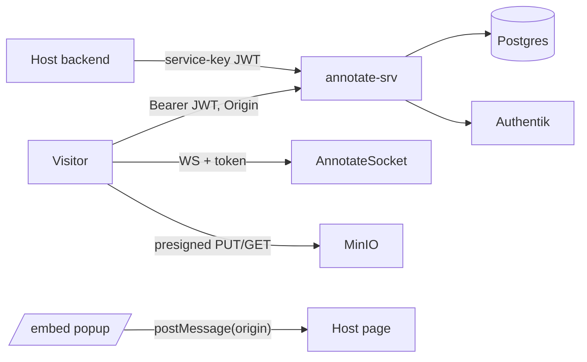

# Threat Model — annotate.therobotlives.com

Security counterpart to [PROJ-ARCH.md](PROJ-ARCH.md). Scope: the embeddable comments service (embed REST API, popup auth broker, host-assert, websocket channel, attachment storage) and the perimeter it is deployed behind. The inherited scaffold surface (PBAC/orgs/invites/password auth/webhooks/media) is only noted in the last section.

Method: read-through of the code at `develop` @ `2b5819d` (2026-10-17). Every finding cites a module. **No dynamic testing or pentest was performed**; items needing runtime or infra confirmation are marked **unknown**. Status values: Mitigated (control present and tested), Partial, Open (no control found), Unknown.

## Assets and actors

Crown jewels: `ANNOTATE_JWT_SECRET` (signs every access token for every tenant), `ANNOTATE_KEY_ENC_SECRET` (unseals per-site service keys), per-site service keys, refresh tokens, Authentik client secret, the Postgres data (commenters incl. emails), the MinIO bucket.

Actors: anonymous internet client; a malicious commenter with a legitimate token on one site; a malicious site owner/host page (tenant A) attacking tenant B; a hostile third-party web page that tries to abuse a visitor's session or the widget; an attacker who obtains a token (XSS on a host page, log leak, shared machine).

## Trust boundaries

1. Browser (host page + widget) -> `annotate-srv` over TLS at the ingress (TLS termination and Cloudflare-only whitelist are Helm options in `helm/annotate/templates/ingress.yaml`; the prod values are **unknown** from this repo).
2. Host page origin -> API: authenticity of the *origin* is asserted only by the browser `Origin` header; non-browser clients can send any value or none.
3. Host backend -> `token/assert`: trust anchored in the per-site service key.
4. Popup (annotate-srv origin) -> opener (host origin) via `postMessage` to a pre-registered origin.
5. API -> Postgres / Valkey / MinIO with credentialed access; browser -> MinIO directly through presigned URLs.
6. API -> Authentik (OIDC code exchange, ID-token verification).

## Findings register

| ID | Sev | Area | Finding | Status |
|---|---|---|---|---|
| T-01 | High | Refresh replay | Refresh token is not bound to an origin or device; the new access token's `origin` is taken from the *request's* `Origin` header, or the site's first `allowed_origins` entry when absent, with no allowlist check | **Fixed** 2026-10-17 (refresh now allowlist-checked and bound to the issuing origin) |
| T-02 | Med | Refresh replay | No reuse detection or family revocation, and rotation is not atomic | Partial |
| T-03 | High | Rate limit | Client IP = first `X-Forwarded-For` value; limiter is per-pod ETS | **Fixed** 2026-10-17 for spoofing (rightmost trusted hop; `site` key validated); per-pod ETS remains a documented limitation |
| T-04 | Med | Uploads | Declared `bytes` and content-type are not enforced or verified at the storage layer; `complete` never checks the object | Open |
| T-05 | Med | Tenant isolation | One global HS256 secret signs tokens for all sites; no `kid`/rotation | Partial |
| T-06 | Med | Authorization | Resolve/reopen/re-anchor need only a site-valid token, not authorship; default policy admits any Authentik user | Open |
| T-07 | Low | XSS | `display_name` is interpolated into an inline `` escaping | Open |
| T-08 | Low | Uploads | Sweeper deletes `pending` rows but never the stored objects; no per-user quota | Open |
| T-09 | Med | Websocket | Token verified once at connect; socket outlives the 15-minute token | Open |
| T-10 | Med | Host-assert | Assertions have no `jti`; replayable for up to 5 minutes | Open |
| T-11 | Low | Identity | Guest names are free text, shared across anonymous users and can imitate real display names | Partial |
| T-12 | Info | CORS | Per-site exact-match CORS works; browser `token/refresh` needs `?site=`; scaffold CORS reflects any Origin outside annotate prefixes | Mitigated / note |
| T-13 | Med | XSS (stored) | Server stores raw markdown and URLs; safety depends on the widget renderer, which is outside this repo | Unknown |
| T-14 | Info | Embed origin | Popup `postMessage` target is the registered origin; origin spoofing needs a non-browser client | Mitigated |

## Detail by threat class

### Token theft and refresh replay

Controls: access tokens live 15 min, HS256 only, `typ=annotate_access`, bound to `site` and `origin` (`Annotate.Auth.ApiToken`, `Plugs.AnnotateAuth`; tests `token_binding_test.exs`). Refresh tokens are 256-bit random, hashed at rest, single use, 30-day TTL, and re-check the site's *current* `comment_policy` on every rotation (`Annotate.Auth.RefreshTokens`, `TokenController.refresh`).

Weaknesses:
- **T-01 (FIXED 2026-10-17)**: `RefreshTokens.rotate/2` now requires the request `Origin` to be an exact member of the token's site `allowed_origins` AND equal to the origin recorded at issuance (stored under `identity_claims["origin"]`, no schema change); a missing, unlisted or different Origin gets `401 origin_mismatch` and the token is not revoked. Tokens issued before binding are constrained by the allowlist only and are re-bound on first rotation. `host_assert` no longer echoes an unlisted Origin into the token claim. Residual: a non-browser holder of a leaked token can still send the legitimate (public) origin string, so binding stops cross-origin and cross-site reuse, not a leak replayed with a forged-correct header. Original finding: `TokenController.claims_origin/2` copies the caller's `Origin` header into the new token (fallback: first allowed origin, else the literal `"unknown"`). `AnnotateCORS` blocks *browsers* from foreign origins, but a stolen refresh token used from a script or curl can mint an access token claiming any allowed origin (or any string) and then send the matching header. The origin claim therefore protects against token reuse by a *different browser origin* only; it is not a defence once a refresh token leaks. Recommendation: validate `Origin` against `site.allowed_origins` on refresh/assert, store the issuance origin on the refresh row, and refuse mismatches.
- **T-02** `rotate/1` selects, then revokes, then issues (three statements, no transaction or `FOR UPDATE`): two concurrent presentations of the same token can both succeed. A replayed *already-rotated* token simply returns `invalid_refresh_token`; nothing revokes the descendant, so an attacker and a victim can each hold a valid chain until one is noticed. Recommendation: revoke the whole chain on reuse and make rotate a single `UPDATE ... WHERE revoked_at IS NULL RETURNING`.
- Access tokens cannot be revoked before `exp` (stateless). Revoking a refresh token takes effect within 15 minutes.
- Where the widget stores tokens (memory vs `localStorage`) is in the tobor-kit widget and **unknown** here; the broker delivers both tokens by `postMessage`.
- Refresh `identity_claims` (email, groups) are persisted on the refresh row (PII at rest; migration `030`).

### Embed origin spoofing and host-assert

- `EmbedController.login` rejects any `origin` not exactly in `sites.allowed_origins` (`Sites.allowed_origin?/2`, no wildcards) and stores it in the signed `_annotate_sso` cookie; `callback` posts to that stored origin only (`window.opener.postMessage(payload, origin)`). A malicious page on another origin cannot receive the tokens. State and nonce are verified with `Plug.Crypto.secure_compare`, failing closed when either side is missing (`verify_state/2`, `verify_nonce/2`; tests `embed_auth_test.exs`). Gaps: no `Cross-Origin-Opener-Policy`/CSP on the callback page (**unknown**/not set in code) and `window.opener` can be null after cross-origin navigations, in which case sign-in silently fails (availability, not security).
- Host-assert (`TokenController.host_assert`): HMAC verification with a key derived from the decrypted service key, `alg` forced to HS256, `sub` required, `exp` required and at most 5 minutes ahead, `comment_policy` applied. **T-10**: no `jti`/nonce and no `iat` bound, so a captured assertion is replayable until `exp`. The asserted `sub` is trusted completely: a compromised service key lets an attacker impersonate any of that site's users and mint refresh tokens. Service keys are shown once, stored as sha256 plus AES-256-GCM (`Annotate.Auth.ServiceKey`); a DB-only leak does not reveal them, a DB leak plus `ANNOTATE_KEY_ENC_SECRET` does. There is no key rotation endpoint (CLI-only provisioning; rotation procedure **unknown**).
- Host-asserted `external_id` values and guest rows share the `external_id` column: a host `sub` beginning `guest:` collides with the guest namespace (`Sites.upsert_guest_commenter/2`) (**T-11**, host-controlled, low).
- Authentik identities are keyed globally by `authentik_sub` (`upsert_commenter_by_sub/2`); the row's `site_id` is the first site the user signed in on. Tokens still carry the signing site, so this is a data-model smell rather than an access bypass. **T-06**: the default `comment_policy` (`required_groups: []`, `allowed_email_domains: []`) admits *any* Authentik account, so unless a site sets a policy, any SSO user can obtain a commenter token on any site.

### CORS

`AnnotateWeb.Plugs.AnnotateCORS` runs first at the endpoint: exact-match allowlist from `allowed_origins`, `Vary: origin`, no credentials header, foreign origins get a bare 403, no Origin passes through (`cors_test.exs`). Annotate prefixes are "claimed" so the scaffold's reflect-any-origin `Plugs.CORS` does not overwrite them. Notes: (1) `/api/v1/token/refresh` carries no site in the path, so a browser preflight/request without `?site=` is denied (403); the widget must append it. (2) The scaffold CORS still reflects any `Origin` (or `*`) on the inherited auth routes; those are bearer-token based, so no credentialed cross-origin cookie risk was found, but it remains broader than needed. Auth uses `Authorization` headers, not cookies, so classic CSRF against the REST API does not apply; the only cookies are the short-lived signed `_annotate_sso` state cookie (SameSite=Lax, HttpOnly per the 2026-10-17 changelog) used by `/embed/*`.

### Upload abuse (type, size, content sniffing)

Controls: content-type allowlist `png/jpeg/webp/gif/pdf/text/plain` (no SVG/HTML), `max_upload_mb` (default 20), filename sanitised to `[A-Za-z0-9._-]`, `Path.basename`, 200 chars, key prefixed with site id and a UUID (`Comments.storage_key/2`, `AttachmentController`); only the uploader can complete; only own, ready, unbound, same-site attachments bind to a comment; presigned URLs expire in 1 h (`Annotate.Storage`).

Gaps (**T-04**): the size cap compares the *client-declared* `bytes`; the presigned PUT signs `content-type` but not `content-length`, so a client can upload more than declared (the bucket-side limit, if any, is **unknown**). The declared type is trusted: no magic-byte sniffing, and `complete` never `HEAD`s the object, so a `ready` attachment may not exist, may be empty, or may contain HTML served as `image/png`. Safety relies on the storage serving the signed content-type with `nosniff` and `Content-Disposition` (**unknown**; MinIO defaults not verified). `width`, `height`, `annotation` are accepted unvalidated (`complete_attachment/2`). **T-08**: `AttachmentSweeper` removes only DB rows older than 24 h, so abandoned objects accumulate; there is no per-commenter or per-site storage quota; write rate limiting is the only brake. Presigned GET URLs are bearer links embedded in every thread payload and websocket broadcast; for `public_read=false` sites they are readable for an hour by anyone who obtains one.

### XSS in comments

Server side: `body_md` is capped at 20 000 chars (`Comment` changeset) and returned as JSON (`Renderer`). Nothing sanitises markdown or `avatar_url`/`display_name` server-side, and anchors are unconstrained maps. Stored XSS therefore depends entirely on the widget renderer in tobor-kit (**T-13, unknown** - not in this repo; a regression test pinning escape behaviour should live with the widget). `avatar_url` comes from IdP `picture` or host assertion without scheme validation (a `javascript:`/tracking URL is possible if the widget uses it unsafely). **T-07**: `EmbedController.postmessage_body/2` interpolates `Jason.encode!(payload)` into an inline script; Jason's default escaping does not neutralise `</script>`, and `display_name` comes from the IdP `name` claim. It requires the attacker to control their own IdP profile name and to sign in through the popup, so it is self-XSS on the annotate-srv origin unless combined with login CSRF; fix with `escape: :html_safe` and a CSP. The landing page, by contrast, carries a strict CSP (`MarketingHostGate`).

### Rate-limit bypass

`Plugs.RateLimit` (Hammer ETS): `annotate_write` 60 / 60 s per `ip:site`, `auth` 10 / 60 s, `auth_sensitive` 5 / 60 s; reads are uncounted (`rate_limit_test.exs`). **T-03 (FIXED 2026-10-17)**: `client_ip/1` now, when `RATE_LIMIT_CLIENT_IP_HEADER=cf-connecting-ip` is set (chart sets it only when `ingress.cloudflareOnly`; prod ingress `whitelist-source-range` admits Cloudflare ranges only, and Cloudflare overwrites the header), takes that header's IP - true per-client limits; residual: in-cluster callers hitting the Service directly could forge it. Otherwise it uses the Nth-from-right `X-Forwarded-For` entry (`RATE_LIMIT_TRUSTED_HOPS`, default 1 = ingress-nginx, which has `use-forwarded-headers` off in prod and so writes the peer address itself), falling back to `conn.remote_ip`; the `site` bucket component is only a real site slug, all unknown values share one `_unknown` bucket. Counters remain per-pod ETS (effective limit scales with replicas) - storage deliberately not redesigned. Original finding: `client_ip/1` took the *first* `X-Forwarded-For` element, which a client controls unless the ingress overwrites rather than appends (the compose nginx uses `$proxy_add_x_forwarded_for`, which appends; prod ingress behaviour is **unknown**). With a spoofed header an attacker gets unlimited buckets. Counters are per pod, so the effective limit scales with replicas (HPA). The `site` bucket component comes from request params and is not validated before limiting, so varying it also mints new buckets. Reads (including `list threads`) and websocket joins are unthrottled. Recommendation: trust only the ingress-set address (`remote_ip` via `RemoteIp` with a trusted proxy list), validate `site` before bucketing, and move counters to Valkey.

### Websocket

Controls: transport `check_origin` requires a registered origin, `connect/3` binds origin to the site, bad tokens are refused rather than downgraded to anonymous, join checks site and `origin` claim, channel is read-only (`annotate_socket_test.exs`, `page_channel_test.exs`). **T-09**: claims are checked once; a socket opened with a 15-minute token stays authorised indefinitely, and there is no disconnect on policy change (`AnnotateSocket.id/1` enables targeted disconnect by commenter but nothing calls it). Origin-less handshakes are accepted by design (native clients) and are bounded by `public_read` and token checks. The origin handoff via the process dictionary (`check_origin/1` -> `connect/3`) relies on Bandit running both in one process (documented in the module; **unverified under other adapters**).

### Tenant isolation

Good: every domain lookup is site-scoped by join (`get_thread_for_site`, `get_comment_for_site`, `get_attachment_for_site`); tokens carry `site` and are rejected on mismatch with 403; topics embed the slug; rate-limit buckets are per site; attachment binding requires same site and same uploader; storage keys are namespaced by site id. Weak points: **T-05** a single global JWT secret and a single `ANNOTATE_KEY_ENC_SECRET` for all tenants (compromise or dev-fallback misuse affects everyone; non-prod falls back to committed dev strings, prod boot fails closed without the env vars, `config/runtime.exs`); one tenant's host page may register any origin string in its own `allowed_origins`, but the websocket transport gate checks *any* site's origin list (`Sites.origin_registered?/1`), so registering `https://victim.example` on a hostile site lets that page pass only the first gate - the per-site binding in `connect/3` still stops cross-site access. Soft-deleted comment bodies remain in the database (privacy/retention, no purge job found).

### Comment authorization (T-06)

Edit/delete: author or site owner (`Comments.comment_manageable_by?/3`, good). Resolve/reopen/re-anchor (`ThreadCommentsController`) check only that the thread belongs to the token's site. Any commenter (including a freshly signed-up Authentik account under the default policy) can resolve, reopen or move the anchor of anyone's thread; `resolve` records the actor but no role check exists. Whether this is intended product behaviour is **unknown**; it is documented here as a risk.

## Residual and inherited surface

The same hosts expose the scaffold's orgs/PBAC/invite/password/magic-link/SSO-domain/SAML/webhook/media routes (`router.ex`). They have their own rate limits (`auth` classes) and an invite gate, but were not reviewed in this pass and are not needed by the embed product; disabling or firewalling them in prod would shrink the attack surface (whether prod already does so is **unknown**). Logging: the embed callback redacts token-shaped strings (`redact/1`); no other log review done. Backups, MinIO bucket policy, ingress annotations and Infisical access policy live in the monorepo Terraform and are out of scope here.

## Recommended next actions (priority order)

1. T-01 (done)/T-02: origin allowlist on refresh/assert, origin stored on the refresh row, atomic rotate with chain revocation on reuse.
2. T-03 (done, except shared limiter): trusted-proxy client IP and shared limiter; validate `site` before bucketing.
3. T-04: sign `content-length` (or use presigned POST with conditions), `HEAD` the object in `complete`, delete objects when sweeping, set `nosniff`/`Content-Disposition` on the bucket.
4. T-06: decide intended resolve/reopen/re-anchor permissions; make the default `comment_policy` explicit at site creation.
5. T-07: `escape: :html_safe` plus CSP on `/embed/callback`.
6. T-09/T-10: expiry-driven socket disconnect; `jti` replay cache for assertions.
7. T-13: add widget-side escape tests; validate `avatar_url` scheme server-side.
