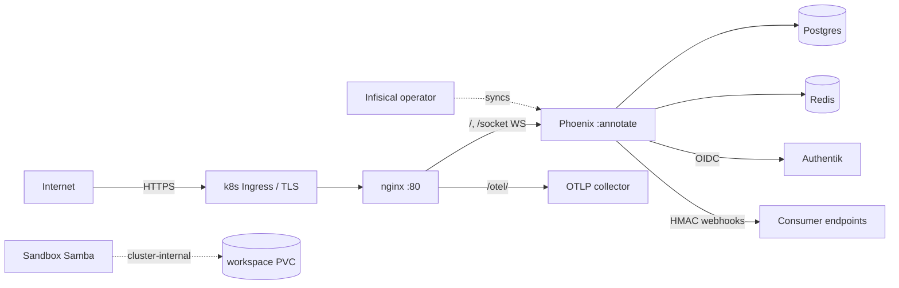

# Threat Model — hologram-start-app

Security counterpart to [PROJ-ARCH.md](PROJ-ARCH.md). Scope: the two-container stack (Phoenix + Hologram backend `:annotate`, nginx reverse proxy), its auth/authz stack, media pipeline, webhook egress, sandbox lane, and the Helm-deployed perimeter. Structure map: [PROJ-LAYOUT.md](PROJ-LAYOUT.md). Because this repo is a **scaffold template**, the model describes the template's controls; hydrated products inherit them and must re-review per product.

## Trust Boundaries

1. **Internet → edge**: TLS terminates at the k8s ingress (`tls.secretName: therobotlives-tls`, Infisical-sourced); nginx itself listens on :80 inside the cluster. Local docker-compose runs plain HTTP on `$PORT` — dev only.
2. **Edge → backend process**: nginx proxies `/` and `/socket` (WebSocket) to Phoenix :4000, and `/otel/` to the OTLP collector. nginx adds no auth of its own.
3. **Backend → stores**: credentialed Postgres/Redis on the shared external Docker network (isolation by credentials, not network).
4. **Cluster → sandbox lane**: separate sandbox deployment (Samba/supervisord, writable workspace PVC) with its own values file.
5. **Process → third parties**: OIDC/Authentik SSO, SMTP egress (EmailWorker), outbound webhook delivery.

Crown jewels: the Postgres data (users, credentials hashes, PBAC policies, media metadata), session/JWT signing secrets, and webhook signing secrets.

## Attack Surface

Entry points: all Hologram pages (`/*` via `Hologram.Router`, incl. `/styleguide`, `/tk-smoke`), `/api/v1/*` JSON (Bearer JWT), `/auth/*` + `/sso/*` OIDC flows, `/socket` channel, `/otel/` proxy, `/nginx-health`, media upload endpoints, sandbox SMB.

## Vulnerability Register

| ID | Severity | STRIDE | Component | Status |
|----|----------|--------|-----------|--------|
| T-001 | High | Spoofing | SSO e-mail-domain identity trust (`SSO_DOMAINS`, `SSO_AUTO_APPROVE_DOMAINS`) | Mitigated — domain allowlist + `pending` admin-approval default for unknown domains; auto-approve is opt-in |
| T-002 | High | Elevation | PBAC JSONB policies with wildcard/template matching (PL/pgSQL) | Partial — deny-overrides-allow, in-DB evaluation; an overly broad wildcard policy is a config error the engine will honor |
| T-003 | Medium | Spoofing | Credential stuffing / brute force on auth endpoints | Mitigated — Hammer rate limiting (`rate_limited_auth`, `rate_limited_sensitive` pipelines) |
| T-004 | Medium | Tampering | Outbound webhooks unsigned when `webhook.secret` is nil (`webhook.secret \|\| ""`) | Partial — HMAC-SHA256 `x-webhook-signature` when secret set; receivers must verify, empty-secret fallback signs with "" |
| T-005 | Medium | DoS / Info | `/otel/` proxy forwards unauthenticated browser RUM traces to collector | Open — collector accepts arbitrary trace ingestion from anyone who can reach the edge |
| T-006 | Medium | Tampering | Media upload → `Transform` (vix/ex_aws) | Partial — format/content-type mapping in transform; visibility + short-id scoping on reads |
| T-007 | High | Elevation | Sandbox lane Samba share (writable `/workspace`, `force user = dev`) | Mitigated — cluster-internal service, `security = user`, `map to guest = Never`, SMB2 minimum, `valid users = dev`; residual = strength of generated `dev` credential |
| T-008 | Low | Info disclosure | Structured JSON logging + OTel metadata may carry PII | Partial — `logger_json` + `Plugs.OtelLoggerMetadata`; no documented PII scrubbing policy |
| T-009 | Medium | DoS | Single backend behind nginx; WebSocket churn | Partial — HPA + PDB in chart; no explicit connection/queue limits |
| T-010 | Low | Tampering | Supply chain: `:tobor_kit_hologram` monorepo path dependency | Mitigated — path dep resolved inside the monorepo (not fetched); TODO noted in mix.exs to pin as git dep when productized |

Session security (cross-cutting): SSO flow cookie is signed, `SameSite=Lax`, 900 s max-age, and fails closed to `state_mismatch` on timeout/tamper; Hologram UI tokens live in the Phoenix session, API uses Guardian JWT from `runtime.exs` secrets. Dev/test `secret_key_base` values are loud placeholders (`CHANGE-ME…`) — production reads real secrets at runtime (Infisical → k8s Secret).

## Mitigation Coverage

5 mitigated · 4 partial · 1 open. The open item (T-005) and partials (T-002, T-004, T-006, T-008, T-009) are template-level decisions each hydrated product should re-rate against its own exposure.

## Residual Risk

- **Shared external Docker network**: infra isolation is credential-based; a compromised peer container can reach Postgres/Redis ports. Accepted for the dev topology; k8s deploys use namespace + Secret boundaries.
- **`/otel/` openness** accepted to keep browser RUM zero-config; revisit if the collector gains multi-tenant or costly backends.
- **Scaffold drift**: hydrated projects rename `Annotate` and may weaken defaults (auto-approve domains, rate limits); the template cannot enforce posture downstream.
